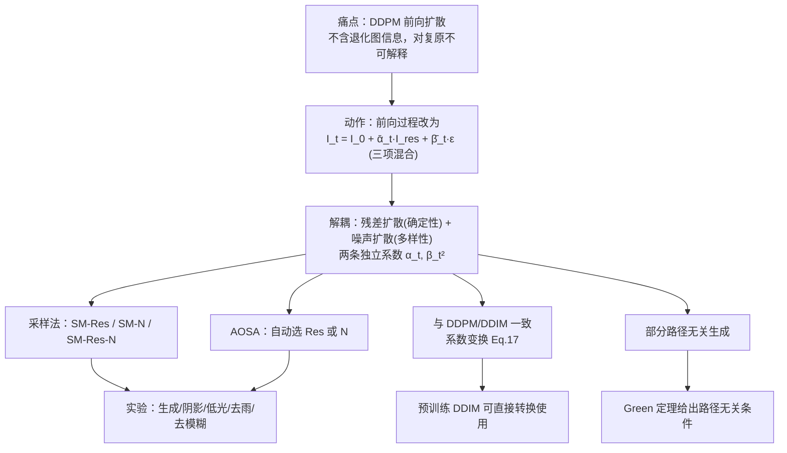

# 1 RDDM (Liu 等, 2024) 精读笔记

> [!abstract] 一句话
> 把 DDPM 的单去噪扩散解耦成**残差扩散（确定性）+ 噪声扩散（多样性）**双通道，用两个独立系数调度控制，从而统一图像生成与复原。

---

## 1.1 论证链条总览

---

## 1.2 解决的问题

- **不可解释性**：DDPM/DDIM 迁移到复原时，前向扩散过程不含退化图信息，退化图只作条件输入。
- **反向过程多余**：复原任务的起点（退化图）本已已知，却从纯噪声出发。

> [!quote]
> However, the reverse process starting from noise seems to be unnecessary, as the degraded image is already known. The forward process is non-interpretability for image restoration, as the diffusion process does not contain any information about the degraded image
> — (Liu 等, 2024)

**是否新问题**：部分是。三项混合形式在同期工作（InDI、I2SB、IRSDE、ResShift）中已出现；论文主张的新颖点是"残差估计 + 保留噪声 + 两独立系数"。

---

## 1.3 核心公式

### 1.3.1 前向单步 (Eq. 6)
$$I_t = I_{t-1} + I_t^{\text{res}}, \quad I_t^{\text{res}} \sim \mathcal{N}(\alpha_t I_{\text{res}}, \beta_t^2 I)$$

### 1.3.2 边际形式 (Eq. 7)
$$I_t = I_0 + \bar\alpha_t I_{\text{res}} + \bar\beta_t \varepsilon, \quad I_{\text{res}} = I_{\text{in}} - I_0$$

### 1.3.3 终点 ($t=T$, $\bar\alpha_T = 1$)
$$I_T = I_{\text{in}} + \bar\beta_T \varepsilon$$

> [!tip] 三个关键点
> 1. **三项混合**：$I_0$、$I_{\text{res}}$、$\varepsilon$ 同时出现，比 DDPM 多一项
> 2. **生成是特例**：$I_{\text{in}}=0 \Rightarrow I_T=\varepsilon$，一个开关统一生成与复原
> 3. **两独立系数**：$\alpha_t$ 管残差速度，$\beta_t^2$ 管噪声速度，**无约束** → 解耦的根源

$\bar\beta_T^2$ 控制终点噪声强度：阴影去除 0.01，图像生成 1。

### 1.3.4 采样递推 (Eq. 12)
$$I_{t-1} = I_t - (\bar\alpha_t - \bar\alpha_{t-1})I^{\theta}_{\text{res}} - (\bar\beta_t - \sqrt{\bar\beta_t^2 - \sigma_t^2})\varepsilon_{\theta} + \sigma_t \varepsilon_t$$

其中 $\sigma_t^2 = \eta \beta_t^2 \bar\beta_{t-1}^2 / \bar\beta_t^2$，$\eta=1$ 随机、$\eta=0$ 确定性。

直觉：每步从 $I_t$ 同时**减掉一份残差、减掉一份噪声**。

### 1.3.5 训练目标 (Eq. 14, 15)
$$L_{\text{res}}(\theta) = \mathbb{E}\left[\lambda_{\text{res}}\|I_{\text{res}} - I^{\theta}_{\text{res}}(I_t,t,I_{\text{in}})\|^2\right]$$
$$L_{\varepsilon}(\theta) = \mathbb{E}\left[\lambda_{\varepsilon}\|\varepsilon - \varepsilon_{\theta}(I_t,t,I_{\text{in}})\|^2\right]$$

### 1.3.6 与 DDIM 的系数变换 (Eq. 17)
$$\bar\alpha_t = 1 - \sqrt{\bar\alpha_t^{\text{DDIM}}}, \quad \bar\beta_t = \sqrt{1 - \bar\alpha_t^{\text{DDIM}}}, \quad \sigma_t^2 = \sigma_t^2(\text{DDIM})$$

**含义**：预训练 DDIM 可直接搬进 RDDM，无需重训。Table 3(a) 验证转换前后 FID 几乎一致。

---

## 1.4 符号辨析与各任务的退化图

> [!tip] 通俗版（先记这一句，比公式管用）
> **$I_{\text{in}}$ 就是"你手里那张坏图"，也就是模型的输入；$I_0$ 是"一开始那张干净原图"，同时也是反向过程最终要输出的真正答案。**
>
> - **前向**：从 $I_0$（干净）一步步走到 $I_T$（坏图 + 噪声）→ 所以 $I_0$ 是前向的**起点**。
> - **反向**：从 $I_T$ 一步步走回 $I_0$ → 所以 $I_0$ 是反向的**终点**，也就是你要的结果。
> - **$I_{\text{in}}$ 全程是已知输入**：训练时它是数据对的一半，推理时它是你唯一拿得到的东西。
> - 残差 $I_{\text{res}} = I_{\text{in}} - I_0$ 就是"坏图比干净图多出来的东西"；把它从 $I_{\text{in}}$ 里减掉，就回到 $I_0$。
>
> 一句话链条：**输入 $I_{\text{in}}$ ──减去残差──▶ 输出 $I_0$**。
>
> 一处严格性提醒：推理时反向过程的真正起点是 $I_T = I_{\text{in}} + \bar\beta_T\varepsilon$，即"坏图再加一点噪声"，不是 $I_{\text{in}}$ 本身。

### 1.4.1 三个图像符号

| 符号 | 含义 | 已知性 |
|---|---|---|
| $I_0$ | 目标干净图（ground truth） | 训练时已知；**推理时未知**（就是要生成的目标） |
| $I_{\text{in}}$ | 退化 / 条件输入图 | 推理时**唯一已知**的图 |
| $I_{\text{res}}$ | 残差 | 训练时由配对数据算出，不需学习 |

> 论文里没有 $R_{\text{in}}$ 这类符号，只有上面三个（外加中间态 $I_t$）。

**三者关系**：

$$I_{\text{in}} = I_0 + I_{\text{res}}, \qquad I_{\text{res}} = I_{\text{in}} - I_0$$

- 残差是 **逐像素的图像差**，由数据给定，不是网络里的可学习参数；
- 论文称其为"从目标图 $I_0$ 到退化输入图 $I_{\text{in}}$ 的方向性扩散"；
- 把 $I_{\text{res}}$ 从 $I_{\text{in}}$ 中减掉就回到 $I_0$，这正是反向过程在做的事（论文里叫 deresidual）。

> [!quote]
> The residuals (Ires = Iin − I0) diffusion represents the directional diffusion from the target image I0 to the degraded input image Iin, while the noise (ε) diffusion represents the random perturbations in the diffusion process.
> — (Liu 等, 2024)

把 $I_{\text{res}} = I_{\text{in}} - I_0$ 代入边际式，可得等价写法：

$$I_t = \bar\alpha_t I_{\text{in}} + (1-\bar\alpha_t)I_0 + \bar\beta_t\varepsilon$$

即前向过程是"**在退化图与干净图之间线性插值，再叠一点噪声**"。对比 DDPM 的两项混合（$I_0$ + 噪声）：DDPM 里没有任何一项编码"退化"，退化信息只能靠网络从条件输入中隐式猜测；RDDM 把"干净 → 退化"这个**方向**显式做成一项。

### 1.4.2 关于"前向退化、反向恢复"的直觉

"前向把清晰图变成退化图、反向学怎么变清晰"——对四个复原任务方向正确，但有一个限定：**论文没有手工设计退化算子**。

- 与 ColdDiffusion 不同（后者对去模糊用高斯模糊、对除雪用 snowification 变换）；
- RDDM 让残差 **直接从配对数据学出**这个方向，不为每个任务设计特定退化算子；
- 所以严格说，前向不是"调用一个模糊函数"，而是"沿 $I_{\text{res}}$ 这个学出的方向走"。

> [!quote]
> RDDM represents directional diffusion from target images to input images using residuals, without designing specific degradation operators for each task.
> — (Liu 等, 2024)

> [!warning] 术语范围
> **这篇论文没有做超分辨率**。它做的"去模糊"（GoPro）退化图确实是模糊图，但超分辨率只在相关工作里被提及（SR3、ResShift 等）。

### 1.4.3 四个复原任务的退化图

| 任务 | 数据集 | $I_0$（目标） | $I_{\text{in}}$（退化图） | $\bar\beta_T^2$ |
|---|---|---|---|---|
| 阴影去除 | ISTD | 无阴影图 | 带阴影照片（另加阴影掩码作条件） | 0.01 |
| 低光增强 | LOL、SID-RGB | 正常亮度图 | 暗光照片（预处理：直方图均衡化） | 1 |
| 去模糊 | GoPro | 清晰图 | 模糊图 | 0.01 |
| 去雨 | RainDrop | 无雨滴图 | 带雨滴照片 | 1 |

终点 $I_T = I_{\text{in}} + \bar\beta_T\varepsilon$ 因此分别是"带噪的阴影图 / 暗光图 / 模糊图 / 带雨滴图"。

> [!note] 看最后一列
> 低光与去雨取 $\bar\beta_T^2 = 1$，终点是退化图**加满强度噪声**；阴影与去模糊取 0.01，几乎就是退化图本身。$\bar\beta_T^2$ 是逐任务调的。

> [!warning] 术语范围
> 论文的 "image restoration" 只指上面四项；**inpainting 与 translation 是另算的两类**，与"图像生成"归在一起（实验设置表中这三类的 $I_{\text{in}}$ 记为 0）。

### 1.4.4 空洞修复（inpainting）的 $I_{\text{in}}$

**论文存在两处不一致的描述，无法据此确定最终配置**：

- **实验设置表**：inpainting 与 translation 的 $I_{\text{in}}$ 一栏记为 **0**，$\bar\beta_T^2 = 1$（起点与生成任务一样是纯噪声）；
- **附录图注与讨论**：inpainting 被描述为从**带噪的退化图**直接生成清晰目标图（Fig. 19(b) 标为 Input+Noise）；条件输入图喂不喂给网络是可选项——不喂则多样性更高但会改动非缺失区域，喂入则确定性更高、多样性下降。

两者逻辑上不等价（前者起点为纯噪声，后者起点为"空洞图 + 噪声"）。**确切实现需以作者开源代码（nachifur/RDDM）为准**，本笔记不替论文下结论。

概念上的答案是清楚的：inpainting 的"退化"是 **结构性遮挡——缺失像素**。$I_{\text{in}}$ 即带空洞的图，$I_0$ 是完整图。

> [!note] 个人推演（非论文原话）
> 若按图注那种配置，$I_{\text{res}} = I_{\text{in}} - I_0$ 在掩码区域内等于 $-I_0$（真实内容的相反数），掩码外为 0——**残差在空间上被限制在空洞内**。若按实验设置表（$I_{\text{in}} = 0$），则退化为 $I_{\text{res}} = -I_0$，与生成任务相同。

> [!bug] 修订记录（2026-10-11）
> 此前口头讨论中把"先翻译语义、再生成细节"归给了 inpainting；**原文那句讲的是图像翻译**（Fig. 7(e)：The image translation process can be regarded as first translating the semantics and then generating the details）。此处已更正。

### 1.4.5 关于"输入含答案"与过拟合的疑问

> [!question] 疑问
> 把 $I_0$ 与 $I_{\text{in}}$ 之间的残差逐步加到前向过程里，岂不是把答案的一部分提前告诉了输入？会不会导致过拟合？

> [!warning] 论文未讨论
> 论文没有提过信息泄露、捷径学习或过拟合。以下是依据论文公式的**个人分析**，不是论文的结论。

**先修正机制**：残差不是"加到输入里"，而是**从 $I_0$ 出发逐步累加**，终点才落在 $I_{\text{in}}$；并且在终点处残差的系数恰好为零：

$$I_t = I_{\text{in}} + (\bar\alpha_t - 1)I_{\text{res}} + \bar\beta_t\varepsilon \quad\Longrightarrow\quad I_T = I_{\text{in}} + \bar\beta_T\varepsilon$$

因为 $\bar\alpha_T = 1$，$(\bar\alpha_T - 1) = 0$，残差项在 $t=T$ 被完全消掉。推理起点处，模型拿到的是"坏图 + 一点噪声"，目标变量没有以显式形式出现。

**你的直觉有一半是对的**：$I_{\text{in}} = I_0 + I_{\text{res}}$，输入里**必然**含有原图内容——这正是复原任务成立的前提。若 $I_{\text{in}}$ 与 $I_0$ 无关，任务本身无解。

**但这不限于 RDDM**：论文指出 InDI、I2SB 与 RDDM 的前向都是三项混合（$I_{\text{in}}$、$I_0$、$\varepsilon$），都超出只有两项（$I_0$、$\varepsilon$）的 DDPM；传统扩散式复原（SR3、DvSR、WeatherDiffusion）同样把退化图当条件输入。"输入与输出相关"是所有配对复原方法的共同结构，不是 RDDM 引入的新漏洞。

**为什么这不等于过拟合**（四条）：

1. **训练与推理输入分布一致**：训练时 $I_t$ 由 Eq. 7 合成，推理从 $I_T$ 逐步迭代，起点落在同一分布，不存在"训练给了额外信息、测试没给"的错配。
2. **推理时无真值参与**：采样每步的 $I_t$ 都来自模型自身输出，$I_0$ 从不出现。训练监督目标是**差值** $I_{\text{res}}$ 而非 $I_0$；时间步按 $t \sim U\{1,\dots,T\}$ 采样，模型必须学到 $t=T$（真值不可见）时也能工作。
3. **没有平凡捷径**：若偷懒取 $\hat I_{\text{res}} = 0$（"什么都不改"），代入 $I^{\theta}_0 = I_t - \bar\alpha_t I^{\theta}_{\text{res}} - \bar\beta_t\varepsilon_{\theta}$ 得带噪退化图，而 $L_{\text{res}} = \mathbb{E}[\|I_{\text{res}} - 0\|^2]$ 会直接惩罚它。所以"复制输入"不是低损失解。
4. **反证**：若输入真把答案泄露出来，只预测噪声的 SM-N 不该在复原任务上崩得那么惨（阴影 PSNR 11.34 / SSIM 0.175、低光 PSNR 16.30，论文称其"对图像复原无效"）。输入若已含答案，这种失败无法解释。

**论文承认的权衡不是过拟合**：论文反复讨论的是**确定性 vs 多样性**的取舍（$\bar\beta_T^2$ 的取值、inpainting 喂不喂条件输入），并把残差带来的"更确定"当成优点（论文称其加速了收敛）。

> [!note] 个人推断（非论文陈述）
> 反过来看，更值得担心的不是"泄露答案"，而是**偏向恒等映射**：阴影去除、去模糊的 $\bar\beta_T^2 = 0.01$，起点几乎就是退化图本身，非退化区域本就接近正确，模型只要输出接近零的残差就能在大部分像素上拿到好看的指标——可能"欠修正"却仍得分不低。这属于任务结构与度量选择的问题，不是信息泄露；论文未针对它做检验。

---

## 1.5 三种采样方法

| 设定 | 损失 | 预测 | 论文建议场景 | 阴影 MAE↓ | 低光 PSNR↑ | 生成 FID↓ |
|---|---|---|---|---|---|---|
| SM-Res | $L_{\text{res}}$ | 残差 $I^{\theta}_{\text{res}}$ | 复原（阴影、低光） | 4.76 | 25.39 | 31.47 |
| SM-N | $L_{\varepsilon}$ | 噪声 $\varepsilon_\theta$ | 生成 | 81.01 | 16.30 | 23.25 |
| SM-Res-N | 两者 | 残差 + 噪声 | 其他复原 | 4.67 | 23.90 | 28.90 |

> [!warning] 注意
> "残差偏向确定性、噪声偏向多样性"是作者的**解释**，Table 1 是**证据**。论文未做形式化证明。

### 1.5.1 AOSA（自动目标选择）
- 把 $\lambda^{\theta}_{\text{res}}$ 设为可学习参数（初始 0.5）
- 对抗式联合训练 → 收敛到单一预测
- 阴影/低光 ≈300 迭代切到残差；生成 ≈1000 迭代切到去噪
- 即插即用，推理开销与常规去噪扩散相同

---

## 1.6 部分路径无关生成

**逻辑链**：

1. **观察**：$\alpha_t$、$\beta_t^2$ 独立 → 可分别设计。最优组合 $\alpha_t$ 线性递减 + $\beta_t^2$ 线性递增（FID 23.25）
2. **问题**：直接改 DDIM 调度会去噪失败（Fig. 5(c)(d)）
3. **病因**：残差被表示为噪声的线性变换（耦合）+ 时间条件 $t$ 不能反映当前噪声强度
4. **解决**：两个独立网络分别估计残差与噪声；时间条件换成 $\bar\alpha_t\!\cdot\!T$ 与 $\bar\beta_t\!\cdot\!T$
5. **结果**：一定范围内调整扩散速度曲线，语义几乎不变（Fig. 6(c)）

**Green 定理解释**：路径无关充要条件为交叉偏导为零
$$\frac{\partial I^{\theta}_{\text{res}}}{\partial \bar\beta(t)} \approx 0, \quad \frac{\partial \varepsilon_{\theta}}{\partial \bar\alpha(t)} \approx 0$$

**限定**：扰动超出范围（如 $\alpha_t,\beta_t^2$ 同改为 $P(x,5)$）仍会失败 → 故称"**部分**"路径无关。

---

## 1.7 实验设计

### 1.7.1 统一设置
- 同一个 UNet（通道 64，乘子 1/2/4/8）
- batch size = 1，L1 损失（生成用 L2）
- 只调：训练迭代数、$\bar\beta_T^2$、采样步数
- $\alpha_t$ 线性递减 $P(1-x,1)$，$\beta_t^2$ 线性递增 $P(x,1)$

### 1.7.2 数据集与结果

| 任务 | 数据集 | 步数 | 关键指标 | RDDM |
|---|---|---|---|---|
| 生成 | CelebA 64/256 | 10 | FID | 23.25 |
| 阴影去除 | ISTD | 5 | MAE / PSNR | 4.67 / 30.91 |
| 低光增强 | LOL | 2 | PSNR / SSIM | 25.39 / 0.937 |
| 低光增强 | SID-RGB | 2 | PSNR | 23.97 |
| 去雨 | RainDrop | 5 | PSNR / SSIM | 32.51 / 0.9563 |
| 去模糊 | GoPro | 2 / 10 | PSNR / SSIM | 32.40 / 0.963 |

### 1.7.3 消融
- Table 1：采样方法
- Table 2：系数调度扫描
- Table 5：网络结构（**单网络 6 通道 MAE 4.57 优于两独立网络 4.67** ← 反直觉）
- Table 10：采样步数
- Table 11：资源效率

> [!warning] 结论与数据的落差
> 去模糊表（Table 9）中 Uformer-B 在 PSNR/SSIM/LPIPS 三项均优于 RDDM（2 步），RDDM 只是"第二好的 LPIPS"（附录原话）。
> 论文结论中"不超过五步达到 SOTA"在阴影/低光/去雨成立，**去模糊要打折扣**。

> [!note] 解耦 vs 性能的权衡
> Table 5 显示联训单网络性能更好，但失去解耦性质。论文未深挖。

---

## 1.8 实验指标：贡献与进步

> [!abstract] 定位
> 论文的贡献清单里**没有单列"指标进步"**，四条贡献都是框架性的（双扩散、部分路径无关、AOSA、多任务实验）。指标在文中主要扮演**验证框架主张的证据**，而非"刷 SOTA"的目标。

### 1.8.1 把指标当验证工具（方法论上的贡献）

**① 用 FID 做一致性检验，而非性能竞赛。** 把预训练 DDIM 的系数变换成 RDDM 后直接采样，对比变换前后：

| 步数 | 5 | 10 | 15 | 20 | 100 |
|---|---|---|---|---|---|
| DDIM | 69.60 | 40.45 | 32.67 | 30.61 | 23.66 |
| DDIM→RDDM | 69.60 | 40.41 | 32.71 | 30.77 | 24.92 |

论文据此称转换前后质量"nearly the same"，支持"无需重训即可复用 DDPM/DDIM 生态"；大步数下的细微劣化被归因于**系数变换的数值表示误差累积**。这里的指标是**等价性证据**，不是"我比你强"。

**② 用 FID/PSNR 的分布来支撑解耦假设。** 这是全文最关键的一次指标使用——两个指标族朝相反方向跑：

| 采样法 | 阴影 MAE↓ | 阴影 PSNR↑ | 低光 PSNR↑ | 去雨 PSNR↑ | 生成 FID↓ | 生成 IS↑ |
|---|---|---|---|---|---|---|
| SM-Res | 4.76 | 30.72 | 25.39 | 31.96 | 31.47 | 1.73 |
| SM-N | 81.01 | 11.34 | 16.30 | 19.15 | **23.25** | **2.05** |
| SM-Res-N | 4.67 | 30.91 | 23.90 | 32.51 | 28.90 | 1.78 |

论文以此得出实践规则：生成用 SM-N，低光用 SM-Res，其余复原用 SM-Res-N。

> [!warning] 证据 vs 解释
> 上表是**证据**；"残差偏向确定性、噪声偏向多样性"是作者的**解释**，未形式化证明。

**③ 用 FID 扫描解耦系数空间，证明"可以设计出更好的调度"。** 同一网络、同一训练与评估下的公平对比：

| 调度 | FID↓ | IS↑ |
|---|---|---|
| Linear (DDIM) | 28.394 | 2.05 |
| Scaled linear | 28.15 | 2.00 |
| Squared cosine | 47.21 | 2.64 |
| $\alpha_t,\beta_t^2$ 均线性递减 | 27.82 | **2.26** |
| $\alpha_t$ 递减 + $\beta_t^2$ 递增 | **23.25** | 2.05 |

最优组合把 FID 从 28.394 降到 23.25（**个人计算：约降 18%**）。注意 IS 列几乎无进步——最好的 IS 2.26 出现在 FID 27.82 那一行，所以这是**单指标**收益。

**④ 把效率做成一级指标。** 论文用参数量 / MACs×步数 / 推理时间三件套：

| 任务 | 方法 | 参数量(M) | MACs(G)×步数 | 推理时间(s) | PSNR↑ |
|---|---|---|---|---|---|
| 低光 | LLformer | 24.51 | 22.0×1 | 0.09 | 23.649 |
| 低光 | LLFlow | 17.42 | 286.33×1 | 0.18 | 25.19 |
| 低光 | **Ours** | **7.73** | 32.9×2 | **0.06** | **25.392** |
| 阴影 | SR3 (1000K) | 155.29 | 155.3×100 | 2.00 | 27.49 |
| 阴影 | **Ours (only res, 80k)** | **7.74** | 33.5×5 | **0.16** | **30.72** |
| 去雨 | RainDiff128 | 109.68 | 248.4×50 | 1.91 | 32.43 |
| 去雨 | **Ours** | **15.47** | 65.8×5 | **0.35** | **32.51** |

论文总结：相比 SR3，RDDM（only res）有约 **10 倍**更少训练迭代、10 倍更少参数、10 倍更快推理，以及 ISTD 上约 **10%** 的 PSNR/SSIM 提升。

**核验（个人计算）**：参数量 155.29/15.49 ≈ 10.0 倍（吻合）；迭代 1000K/80k = **12.5 倍**、推理 2.00/0.16 = **12.5 倍**（都比"10 倍"更大）；PSNR 30.72/27.49 ≈ **+11.8%**、SSIM 0.959/0.871 ≈ **+10.1%**。所以"10 倍 / 10%"是**约数式概括**，方向成立。另：SM-Res 训练只需 **4.8G 显存**。

**⑤ 步数—指标曲线给出反直觉结论。** 与 InDI（1 步 MSE 最好）相反，RDDM 在阴影去除上 **5 步**最佳。$\bar\beta_T^2=0.01$ 时 MAE 依次为（1/2/5/10/100 步）：4.83 / 4.69 / **4.67** / 4.72 / 4.90。

**⑥ 收敛速度也用指标量化 + AOSA 的门槛数字。** 更少迭代却更高性能被用作"残差加速收敛"的证据；AOSA 报告阴影/低光约 **300** 次迭代切到残差学习，生成约 **1000** 次切到去噪学习，额外开销**少于 1000** 次迭代。

### 1.8.2 数值进步（"最好值 vs 最强对照"）

| 任务 | 数据集 | 指标 | RDDM | 最强对照 | 谁更优 |
|---|---|---|---|---|---|
| 阴影去除 | ISTD | MAE(ALL)↓ | **4.67** | DMTN 4.72 | RDDM |
| | | PSNR(ALL)↑ | **30.91** | DMTN 30.42 | RDDM |
| | | PSNR(阴影区 S)↑ | 36.74 | UnfoldingNet 36.95 | 对照 |
| | | SSIM(ALL)↑ | 0.962 | DMTN 0.965 | 对照 |
| | | LPIPS↓ | **0.0305** | DMTN 0.0368 | RDDM |
| 低光 | LOL | PSNR↑ | **25.392** | LLFlow 25.19 | RDDM |
| | | SSIM↑ | **0.937** | LLFlow 0.93 | RDDM |
| | | LPIPS↓ | 0.116 | LLFlow 0.11 | 对照 |
| 低光 | SID-RGB | PSNR↑ | **23.97** | SNR-Aware 22.87 | RDDM |
| | | SSIM↑ | **0.8392** | SNR-Aware 0.625 | RDDM |
| | | LPIPS↓ | **0.2433** | UTVNet 0.3417 | RDDM |
| 去雨 | RainDrop | PSNR↑ | **32.51** | RainDiff128 32.43 | RDDM |
| | | SSIM↑ | **0.9563** | RainDiff64 0.9422 | RDDM |
| 去模糊 | GoPro | PSNR↑ | 32.40 (2 步) | Uformer-B 32.97 | 对照 |
| | | SSIM↑ | 0.963 | Uformer-B 0.967 | 对照 |
| | | LPIPS↓ | 0.0415 (2 步) | Uformer-B 0.0089 | 对照 |
| 生成 | CelebA 64 | FID↓ | **23.25** | DDIM 线性 28.394 | RDDM |

**这些数字的分量在于"代价极低"**：五类任务共用同一个 UNet（通道 64，乘子 1/2/4/8）、batch size 为 1、只用 L1 损失、采样步数 ≤5，只调训练迭代数、$\bar\beta_T^2$ 与步数。对照组普遍是任务特化架构（多阶段、多分支、Transformer、GAN）或专门损失（色度、纹理相似度、边缘损失）。

**论文唯一的百分数断言可核验**：称 SID-RGB 相比 SNR-Aware，PSNR 提升 **4.8%**、SSIM 提升 **34.2%**。**个人验算**：23.97/22.87 ≈ **+4.8%**、0.8392/0.625 ≈ **+34.3%**——与论文一致。

**附加的方差层面性质**：系数变换带来的和约束方差（$\sum_t \sigma_t^2 \le 1$）远小于 DDPM 的保方差策略，可不重训直接套用到预训练 DDPM。

### 1.8.3 没赢的地方与措辞落差

1. **去模糊三项全输**（见上表）。论文自己承认 RDDM 只是"**第二好的 LPIPS**"——**精确说**：达到第二好的是 10 步版（LPIPS 0.0379），2 步版 0.0415 实为第三。
2. **阴影 SSIM(ALL) 与阴影区 PSNR 不是最好**（0.962 < DMTN 0.965；36.74 < UnfoldingNet 36.95）。
3. **低光 LPIPS 输给 LLFlow**（0.116 > 0.11）。
4. **措辞从紧到松**：摘要是 "compete with state-of-the-art"，结论升格为 "achieves SOTA performance in no more than five sampling steps"。后者在**去模糊**上站不住（2 步最佳 PSNR 32.40 < MPRNet 32.66 < Uformer-B 32.97）。
5. **生成侧 FID 自带限定**：论文脚注称实现基于 lucidrains 的 denoising-diffusion-pytorch，网络结构与训练细节差异 "may lead to poorer FID"。故 Table 2 的绝对 FID 只宜在**同构对比内**解读（28.394 → 23.25），不宜跨论文比较。
6. **泛化实验里指标分化**（Table 6）：SM-Res-N-1Net（单网络 6 通道）阴影 MAE 4.57 优于两独立网络 4.67，但去雨 31.79、去模糊 31.69 略逊（对应 32.51 / 32.40），生成 FID 28.57 反而略优（28.90）。即"性能最优"与"保持解耦性质"存在权衡，论文未深挖。

### 1.8.4 为什么没有对比 Repaint / BrushNet 这类图像修复模型？

> [!warning] 论文未说明理由
> 论文没有解释为何不把这类修复模型作为基线。以下是**事实陈述 + 个人推断**两部分，推断部分已明确标注。

**事实层（可核验）**

- **Repaint（Lugmayr 等, 2022）被引用了**：它是论文参考文献 [39]，并在相关工作里被归入"基于 DDPM/DDIM、把退化图当条件输入"的那一类（与 [14]、[48] 并列，代表工作还有 DvSR、SR3、WeatherDiffusion）。
- **但它从未作为定量基线出现**：论文用到 Repaint 的地方，只是把它当作"反向过程从噪声开始、需要大步数与大 batch"这类方法的**动机来源**，用来支撑"这个反向过程对复原多余"的论点——即**被批评/对照的对象，不是被比较的对象**。
- **BrushNet 未被引用**：论文 82 篇参考文献中没有它（该模型与本文同年出现，属同期工作）。
- **全篇没有任何 inpainting 的定量对比表**：定量表只覆盖生成（CelebA）、阴影（ISTD）、低光（LOL / SID-RGB）、去雨（RainDrop）、去模糊（GoPro）；inpainting 与 translation **只有定性结果**（Fig. 14、Fig. 15、Fig. 19）。

**可推导的原因（个人推断，非论文陈述）**

1. **定位不同**：论文把 inpainting / translation 当作"潜力演示"而非被评测的任务。原文说展示这些例子是为验证 RDDM"有潜力"成为统一的 image-to-image 方法，并明确 "We do not intend to achieve optimal performance on all tasks by tuning all hyperparameters"。
2. **实验尺度相差太大**：论文自己的 inpainting 设置是 CelebA-HQ **64×64**、通用 UNet 从头训练（batch 64、10 步采样、$I_{\text{in}}$ 按表记为 0）；而 Repaint / BrushNet 属于高分辨率、依托大规模预训练扩散主干的修复系统（后半句属**论文之外的公开背景知识**）。直接对比会把"主干规模"与"扩散公式"两个变量混在一起，而本文要验证的是后者。
3. **Repaint 在文中的角色是"被超越的动机"**：既然论文的论点是"从噪声出发的反向过程对复原多余"，那么把一个从噪声出发的重采样式方法与自己的方法并排比数值，与其论证结构并不契合。
4. **时间因素**：BrushNet 属同期工作，很可能在本文定稿时尚未进入其对比范围。**此条为推测**。

**影响（个人推断）**：因此论文关于 inpainting 的结论只能算**可行性展示**，不构成"与专用修复模型可比"的证据；若关心 inpainting 的实际水平，需要另找基准（如 Repaint、BrushNet 各自的评测）。

### 1.8.5 一句话总结

方法层：FID/PSNR 被用作**一致性检验**与**解耦假设的证据**；参数/MACs/推理时间被提为一级指标；并给出"5 步最优"这种反直觉结论。数值层：阴影（MAE-ALL / PSNR-ALL / LPIPS）、低光（PSNR/SSIM）、SID-RGB（三项全胜）、去雨（PSNR/SSIM）、生成调度（FID 28.394 → 23.25）均领先，代价是同一 UNet + batch 1 + L1 + ≤5 步、约 10 倍更小的参数量；但**去模糊是明确短板**，阴影 SSIM、低光 LPIPS 也未夺魁，结论中的"SOTA"措辞在去模糊上不成立。此外 **inpainting 无任何定量基线**，只能算可行性展示。

---

## 1.9 相关工作归类

| 类别 | 代表工作 | 与 RDDM 关系 |
|---|---|---|
| 去噪扩散基础 | DDPM (Ho 等, 2020)、DDIM (Song 等, 2021) | 被扩展的基线 |
| 方差/目标参数化 | IDDPM (Nichol & Dhariwal, 2021)、LDM (Rombach 等, 2022) | IDDPM 只去噪，不同时预测 $I_0$ 与 $\varepsilon$ |
| 扩散式复原 | SR3 (Saharia 等, 2022)、DvSR (Whang 等, 2022)、Repaint (Lugmayr 等, 2022) | 论文批评其步数多、batch 大；Repaint 被引用但未作定量基线 |
| 从退化图直接生成 | SDEdit (Meng 等, 2021)、ColdDiffusion (Bansal 等, 2022)、InDI (Delbracio & Milanfar, 2023)、I2SB (Liu 等, 2023) | InDI/I2SB 是"最相关"同期工作 |
| 残差/流形式 | Rectified Flow (Liu 等, 2023)、ResShift (Yue 等, 2023) | $\bar\beta_T=0$ 时退化为 Rectified Flow |

---

## 1.10 贡献

1. 提出双扩散框架，残差扩散表示目标图 → 条件输入图的方向性扩散
2. 提出部分路径无关生成过程，解耦残差与噪声的角色
3. 设计 AOSA，为未知任务自动选择预测目标
4. 大量实验：同一通用 UNet + L1 + batch 1 即可与 SOTA 竞争

**附加框架层面结果**：系数变换兼容 DDPM/DDIM；和约束方差（$\sum\sigma_t^2 \le 1$）可直接用于预训练 DDPM。

---

## 1.11 局限与未来工作

### 1.11.1 论文自陈局限
> [!quote]
> Our primary focus has been on developing a unified prototype model for image restoration and generation, which may result in certain performance limitations when compared to task-specific state-of-the-art methods.
> — (Liu 等, 2024)

### 1.11.2 论文列出的 Further Work
1. 深入分析 RDDM 与曲线/多元积分的关系
2. 一套预训练参数处理多个任务
3. 自适应学习系数调度（减少步数 + 提升质量）
4. 可解释多维潜扩散模型（多模态融合）
5. 为未知任务自适应学习噪声强度 $\beta_T^2$
6. 在蒸馏中探索残差（如引入一致性模型）

### 1.11.3 我认为可继续深挖的点（个人推断，非论文陈述）
- Table 5 的"解耦 vs 性能"权衡
- SM-N 在复原上的系统性失败（颜色失真，加步数也无改善），论文推测与 batch size 1 有关，引 DeS3 抗色偏损失为旁证
- §1.4.4 里 inpainting 的 $I_{\text{in}}$ 两处描述不一致，值得看代码核实
- inpainting 缺少定量基线（详见 §1.8.4），若要自评需自建对照

---

## 1.12 自检三问

- [ ] RDDM 相对 DDPM，前向过程只改了一件事，是什么？
      → 多了一个独立系数控制的**残差项**
- [ ] 为什么复原适合预测残差、生成适合预测噪声？
      → 论文给的**经验规律** + "确定性/多样性"解释，未形式化证明
- [ ] "部分路径无关"里"部分"指什么？
      → 扰动幅度在**有限范围内**才成立，过度扰动失败
- [ ] $I_{\text{in}}$ 与 $I_0$ 的区别是什么？
      → $I_0$ 是想要的干净图（推理时未知），$I_{\text{in}}$ 是手里那张坏图（推理时已知），$I_{\text{res}} = I_{\text{in}} - I_0$
- [ ] DDPM 的两项混合是哪两项？
      → $I_t = \sqrt{\bar\alpha_t}I_0 + \sqrt{1-\bar\alpha_t}\varepsilon$，即**干净图 $I_0$ + 高斯噪声 $\varepsilon$**（Eq. 3）
- [ ] 论文的指标进步里哪一项是明确落后的？
      → **去模糊**（GoPro）：PSNR/SSIM/LPIPS 三项均不敌 Uformer-B

---

## 1.13 不同目的的读法

| 目的 | 精读 | 可略读 |
|---|---|---|
| 做自己任务的复原 | §4.1–4.3、附录 B.1 Table 4、附录 B.2 | §5 理论、Green 定理 |
| 关心扩散理论 | §5.1–5.2、附录 A.3–A.5 | 任务定量表 |
| 复现/调参 | 附录 A.3 Algorithm 1、Table 4、Table 10 | 相关工作、可视化附录 |
| 关心领域脉络 | §2 + 附录 A.5 | 具体结果数字 |
| 关心指标与对比是否公平 | §1.8、Table 1/2/3/6/9/11 | §1.3 公式推导 |

---

Written by LLM-for-Zotero.
