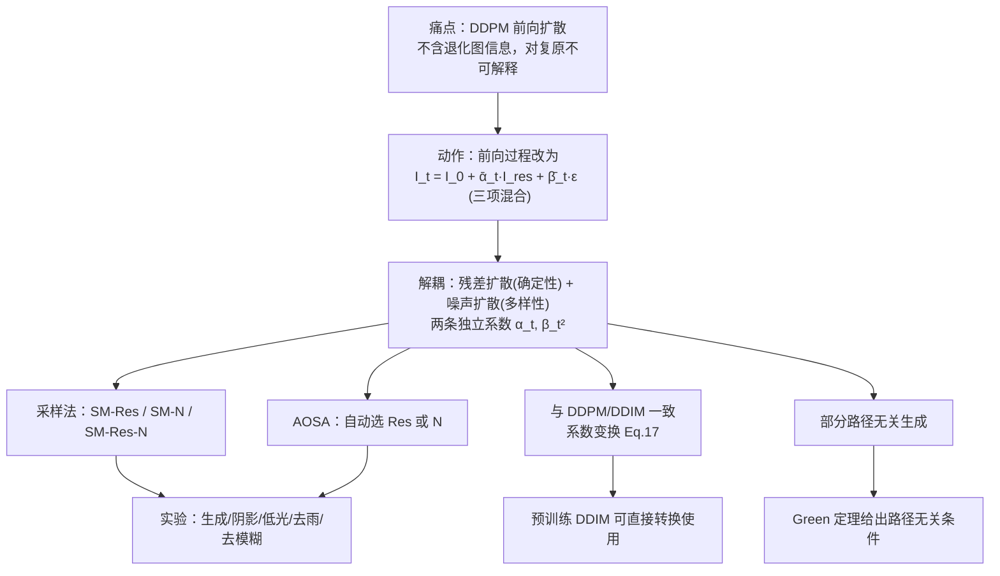

# 1 RDDM (Liu 等, 2024) 精读笔记

> [!abstract] 一句话
> 把 DDPM 的单去噪扩散解耦成**残差扩散（确定性）+ 噪声扩散（多样性）**双通道，用两个独立系数调度控制，从而统一图像生成与复原。

---

## 1.1 论证链条总览

---

## 1.2 解决的问题

- **不可解释性**：DDPM/DDIM 迁移到复原时，前向扩散过程不含退化图信息，退化图只作条件输入。
- **反向过程多余**：复原任务的起点（退化图）本已已知，却从纯噪声出发。

> [!quote]
> However, the reverse process starting from noise seems to be unnecessary, as the degraded image is already known. The forward process is non-interpretability for image restoration, as the diffusion process does not contain any information about the degraded image
> — (Liu 等, 2024)

**是否新问题**：部分是。三项混合形式在同期工作（InDI、I2SB、IRSDE、ResShift）中已出现；论文主张的新颖点是"残差估计 + 保留噪声 + 两独立系数"。

---

## 1.3 核心公式

### 1.3.1 前向单步 (Eq. 6)
$$I_t = I_{t-1} + I_t^{\text{res}}, \quad I_t^{\text{res}} \sim \mathcal{N}(\alpha_t I_{\text{res}}, \beta_t^2 I)$$

### 1.3.2 边际形式 (Eq. 7)
$$I_t = I_0 + \bar\alpha_t I_{\text{res}} + \bar\beta_t \varepsilon, \quad I_{\text{res}} = I_{\text{in}} - I_0$$

### 1.3.3 终点 ($t=T$, $\bar\alpha_T = 1$)
$$I_T = I_{\text{in}} + \bar\beta_T \varepsilon$$

> [!tip] 三个关键点
> 1. **三项混合**：$I_0$、$I_{\text{res}}$、$\varepsilon$ 同时出现，比 DDPM 多一项
> 2. **生成是特例**：$I_{\text{in}}=0 \Rightarrow I_T=\varepsilon$，一个开关统一生成与复原
> 3. **两独立系数**：$\alpha_t$ 管残差速度，$\beta_t^2$ 管噪声速度，**无约束** → 解耦的根源

$\bar\beta_T^2$ 控制终点噪声强度：阴影去除 0.01，图像生成 1。

### 1.3.4 采样递推 (Eq. 12)
$$I_{t-1} = I_t - (\bar\alpha_t - \bar\alpha_{t-1})I^{\theta}_{\text{res}} - (\bar\beta_t - \sqrt{\bar\beta_t^2 - \sigma_t^2})\varepsilon_{\theta} + \sigma_t \varepsilon_t$$

其中 $\sigma_t^2 = \eta \beta_t^2 \bar\beta_{t-1}^2 / \bar\beta_t^2$，$\eta=1$ 随机、$\eta=0$ 确定性。

直觉：每步从 $I_t$ 同时**减掉一份残差、减掉一份噪声**。

### 1.3.5 训练目标 (Eq. 14, 15)
$$L_{\text{res}}(\theta) = \mathbb{E}\left[\lambda_{\text{res}}\|I_{\text{res}} - I^{\theta}_{\text{res}}(I_t,t,I_{\text{in}})\|^2\right]$$
$$L_{\varepsilon}(\theta) = \mathbb{E}\left[\lambda_{\varepsilon}\|\varepsilon - \varepsilon_{\theta}(I_t,t,I_{\text{in}})\|^2\right]$$

### 1.3.6 与 DDIM 的系数变换 (Eq. 17)
$$\bar\alpha_t = 1 - \sqrt{\bar\alpha_t^{\text{DDIM}}}, \quad \bar\beta_t = \sqrt{1 - \bar\alpha_t^{\text{DDIM}}}, \quad \sigma_t^2 = \sigma_t^2(\text{DDIM})$$

**含义**：预训练 DDIM 可直接搬进 RDDM，无需重训。Table 3(a) 验证转换前后 FID 几乎一致。

---

## 1.4 三种采样方法

| 设定 | 损失 | 预测 | 论文建议场景 | 阴影 MAE↓ | 低光 PSNR↑ | 生成 FID↓ |
|---|---|---|---|---|---|---|
| SM-Res | $L_{\text{res}}$ | 残差 $I^{\theta}_{\text{res}}$ | 复原（阴影、低光） | 4.76 | 25.39 | 31.47 |
| SM-N | $L_{\varepsilon}$ | 噪声 $\varepsilon_\theta$ | 生成 | 81.01 | 16.30 | 23.25 |
| SM-Res-N | 两者 | 残差 + 噪声 | 其他复原 | 4.67 | 23.90 | 28.90 |

> [!warning] 注意
> "残差偏向确定性、噪声偏向多样性"是作者的**解释**，Table 1 是**证据**。论文未做形式化证明。

### 1.4.1 AOSA（自动目标选择）
- 把 $\lambda^{\theta}_{\text{res}}$ 设为可学习参数（初始 0.5）
- 对抗式联合训练 → 收敛到单一预测
- 阴影/低光 ≈300 迭代切到残差；生成 ≈1000 迭代切到去噪
- 即插即用，推理开销与常规去噪扩散相同

---

## 1.5 部分路径无关生成

**逻辑链**：

1. **观察**：$\alpha_t$、$\beta_t^2$ 独立 → 可分别设计。最优组合 $\alpha_t$ 线性递减 + $\beta_t^2$ 线性递增（FID 23.25）
2. **问题**：直接改 DDIM 调度会去噪失败（Fig. 5(c)(d)）
3. **病因**：残差被表示为噪声的线性变换（耦合）+ 时间条件 $t$ 不能反映当前噪声强度
4. **解决**：两个独立网络分别估计残差与噪声；时间条件换成 $\bar\alpha_t\!\cdot\!T$ 与 $\bar\beta_t\!\cdot\!T$
5. **结果**：一定范围内调整扩散速度曲线，语义几乎不变（Fig. 6(c)）

**Green 定理解释**：路径无关充要条件为交叉偏导为零
$$\frac{\partial I^{\theta}_{\text{res}}}{\partial \bar\beta(t)} \approx 0, \quad \frac{\partial \varepsilon_{\theta}}{\partial \bar\alpha(t)} \approx 0$$

**限定**：扰动超出范围（如 $\alpha_t,\beta_t^2$ 同改为 $P(x,5)$）仍会失败 → 故称"**部分**"路径无关。

---

## 1.6 实验设计

### 1.6.1 统一设置
- 同一个 UNet（通道 64，乘子 1/2/4/8）
- batch size = 1，L1 损失（生成用 L2）
- 只调：训练迭代数、$\bar\beta_T^2$、采样步数
- $\alpha_t$ 线性递减 $P(1-x,1)$，$\beta_t^2$ 线性递增 $P(x,1)$

### 1.6.2 数据集与结果

| 任务 | 数据集 | 步数 | 关键指标 | RDDM |
|---|---|---|---|---|
| 生成 | CelebA 64/256 | 10 | FID | 23.25 |
| 阴影去除 | ISTD | 5 | MAE / PSNR | 4.67 / 30.91 |
| 低光增强 | LOL | 2 | PSNR / SSIM | 25.39 / 0.937 |
| 低光增强 | SID-RGB | 2 | PSNR | 23.97 |
| 去雨 | RainDrop | 5 | PSNR / SSIM | 32.51 / 0.9563 |
| 去模糊 | GoPro | 2 / 10 | PSNR / SSIM | 32.40 / 0.963 |

### 1.6.3 消融
- Table 1：采样方法
- Table 2：系数调度扫描
- Table 5：网络结构（**单网络 6 通道 MAE 4.57 优于两独立网络 4.67** ← 反直觉）
- Table 10：采样步数
- Table 11：资源效率

> [!warning] 结论与数据的落差
> 去模糊表（Table 9）中 Uformer-B 在 PSNR/SSIM/LPIPS 三项均优于 RDDM（2 步），RDDM 只是"第二好的 LPIPS"（附录原话）。
> 论文结论中"不超过五步达到 SOTA"在阴影/低光/去雨成立，**去模糊要打折扣**。

> [!note] 解耦 vs 性能的权衡
> Table 5 显示联训单网络性能更好，但失去解耦性质。论文未深挖。

---

## 1.7 相关工作归类

| 类别 | 代表工作 | 与 RDDM 关系 |
|---|---|---|
| 去噪扩散基础 | DDPM (Ho 等, 2020)、DDIM (Song 等, 2021) | 被扩展的基线 |
| 方差/目标参数化 | IDDPM (Nichol & Dhariwal, 2021)、LDM (Rombach 等, 2022) | IDDPM 只去噪，不同时预测 $I_0$ 与 $\varepsilon$ |
| 扩散式复原 | SR3 (Saharia 等, 2022)、DvSR (Whang 等, 2022) | 论文批评其步数多、batch 大 |
| 从退化图直接生成 | SDEdit (Meng 等, 2021)、ColdDiffusion (Bansal 等, 2022)、InDI (Delbracio & Milanfar, 2023)、I2SB (Liu 等, 2023) | InDI/I2SB 是"最相关"同期工作 |
| 残差/流形式 | Rectified Flow (Liu 等, 2023)、ResShift (Yue 等, 2023) | $\bar\beta_T=0$ 时退化为 Rectified Flow |

---

## 1.8 贡献

1. 提出双扩散框架，残差扩散表示目标图 → 条件输入图的方向性扩散
2. 提出部分路径无关生成过程，解耦残差与噪声的角色
3. 设计 AOSA，为未知任务自动选择预测目标
4. 大量实验：同一通用 UNet + L1 + batch 1 即可与 SOTA 竞争

**附加框架层面结果**：系数变换兼容 DDPM/DDIM；和约束方差（$\sum\sigma_t^2 \le 1$）可直接用于预训练 DDPM。

---

## 1.9 局限与未来工作

### 1.9.1 论文自陈局限
> [!quote]
> Our primary focus has been on developing a unified prototype model for image restoration and generation, which may result in certain performance limitations when compared to task-specific state-of-the-art methods.
> — (Liu 等, 2024)

### 1.9.2 论文列出的 Further Work
1. 深入分析 RDDM 与曲线/多元积分的关系
2. 一套预训练参数处理多个任务
3. 自适应学习系数调度（减少步数 + 提升质量）
4. 可解释多维潜扩散模型（多模态融合）
5. 为未知任务自适应学习噪声强度 $\beta_T^2$
6. 在蒸馏中探索残差（如引入一致性模型）

### 1.9.3 我认为可继续深挖的点（个人推断，非论文陈述）
- Table 5 的"解耦 vs 性能"权衡
- SM-N 在复原上的系统性失败（颜色失真，加步数也无改善），论文推测与 batch size 1 有关，引 DeS3 抗色偏损失为旁证

---

## 1.10 自检三问

- [ ] RDDM 相对 DDPM，前向过程只改了一件事，是什么？
      → 多了一个独立系数控制的**残差项**
- [ ] 为什么复原适合预测残差、生成适合预测噪声？
      → 论文给的**经验规律** + "确定性/多样性"解释，未形式化证明
- [ ] "部分路径无关"里"部分"指什么？
      → 扰动幅度在**有限范围内**才成立，过度扰动失败

---

## 1.11 不同目的的读法

| 目的 | 精读 | 可略读 |
|---|---|---|
| 做自己任务的复原 | §4.1–4.3、附录 B.1 Table 4、附录 B.2 | §5 理论、Green 定理 |
| 关心扩散理论 | §5.1–5.2、附录 A.3–A.5 | 任务定量表 |
| 复现/调参 | 附录 A.3 Algorithm 1、Table 4、Table 10 | 相关工作、可视化附录 |
| 关心领域脉络 | §2 + 附录 A.5 | 具体结果数字 |

---

Written by LLM-for-Zotero.
